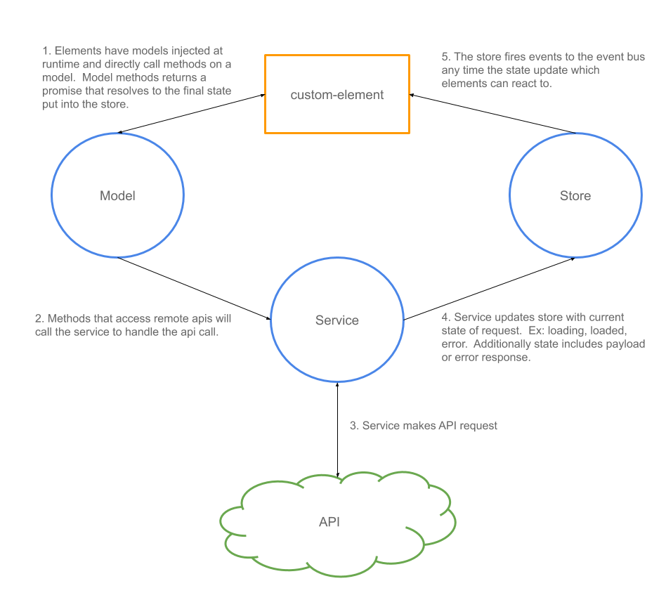

# Cork App Utils

- [Install](#install)
- [BaseModel](#basemodel)
- [BaseService](#baseservice)
- [BaseStore](#basestore)
- [EventBus](#eventbus)
- [Wiring to UI](#wiring-to-ui)
- [Logger](#logger)
  - [Logger Config](#logger-config)
- [Error Reporting](#error-reporting)
- [LruStore](#lrustore)
- [Caching](#caching)
  - [clearCache](#clearcache)
- [CLI](#cli)

# Install

```bash
npm i -s @ucd-lib/cork-app-utils 
```

# Overview



# BaseModel

The BaseModel exposes the event bus and has helper methods
for registering with the global model registry.  This global object
is used by Element interface mixins to inject the models into
elements.

### Attributes

 - eventBus : EventBus

### Methods

 - register(name: String)
   - Register the model
 - emit(event: String, payload: Object)
   - Emit event to event bus

### Example Usage

```javascript
import {BaseModel} from '@ucd-lib/cork-app-utils';
import ExampleStore from '../stores/ExampleStore';
import ExampleService from '../service/ExampleService';

class ExampleModel extends BaseModel {

  constructor() {
    super();

    this.store = ExampleStore;
    this.service = ExampleService;

    this.register('ExampleModel');

    // If you want to add other models
    // this.inject('AnotherModel');
    // Make sure in your main index.js file to call
    // import {Registry} from '@ucd-lib/cork-app-utils';
    // // import models
    // Registry.ready();
  }

  /**
   * @method get
   * @description In this example we will fetch some data
   * using our service.  The service may return some
   * data already cached in the store.  The returned 
   * data will be in a State Payload Wrapper.
   * In most cases, we simply need to call the service
   *
   * @returns {Promise}
   */
  async get(id) {
    return this.service.get()
  }

  /**
   * @method set
   * @description Update some app data
   */
  async set(data) {
    const res = await this.store.update(data);
    if ( res.state === 'loaded' ) {
      // clear relevant caches here
      this.store.data.byId.purge();
    }
    return res;
  }
}

const exampleModel = new ExampleModel();
export default exampleModel;
```

## Loading Models

Here is a sample `index.js` file for the `./src` folder.  Where `./src` contains `./src/models`, `./src/services`, `./src/stores`, etc.

index.js:
```js
import {Registry} from '@ucd-lib/cork-app-utils';

import ExampleModel from './models/ExampleModel.js';
import AnotherModel from './models/AnotherModel.js';

// This handles inject of other models into models, avoiding
// cyclical dependency issues
Registry.ready();

// then if you want to expose
// export {ExampleModel, AnotherModel};
// or
// if( typeof window !== 'undefined' ) {
//   window.APP_MODELS = {ExampleModel, AnotherModel};
// }
// or
// access via registry.models
```

# BaseService

The BaseService exposes helper functions to call rest services

### Attributes

 - eventBus : EventBus

### Methods

 - request(options: Object)
   - Make a fetch request

### Example Usage

```javascript
import {BaseService} from '@ucd-lib/cork-app-utils';
import ExampleStore from '../stores/ExampleStore';

import payload from './payload.js';
import { digest } from '@ucd-lib/cork-app-utils';

class ExampleService extends BaseService {

  constructor() {
    super();

    this.store = ExampleStore;
  }

  async get(id) {
    // LruStore where the data will be written
    const store = this.store.data.byId;

    await this.checkRequesting(
      id, store,
      () => this.request({
        url : `/api/get/${id}`,
        // if request has been made before, will return cached version
        // exclude if you never want to get cached data
        checkCached : () => store.get(id),

        // preferred pattern is to use onUpdate callback which automatically
        // sets the correct state (loading, loaded, error)
        onUpdate : resp => this.store.set(
          {...resp, id},
          store
        ),

        // instead of onUpdate, you can manually handle state with the following callbacks
        // for advanced use cases only. Requires creating custom handlers in the store.
        onLoading : request => this.store.setLoading(id, request),
        onLoad : result => this.store.setLoaded(id, result.body),
        onError : e => this.store.setError(id, e)
      })
    );
    return store.get(id);
  }

  /**
   * Requests are saved/accessed in the store by a unique id.
   * cork-app-utils has built-in methods for generating an id from an object
   */
  async query(query={}){
    // option 1, for large queries
    let id = await digest(query);

    // option 2, if you know the keys that will be in the query and there are a limited number
    const id = payload.getKey(query);
    // then in this.request do:
    // onUpdate : resp => this.store.set(
    //   payload.generate(ido, resp),
    //   store
    // )
  }

  // continue doing normal checkRequesting/this.request here
}

const exampleService = new ExampleService();
export default exampleService;
```

```js
//payload.js
import {PayloadUtils} from '@ucd-lib/cork-app-utils'

const ID_ORDER = ['org', 'name', 'other keys you know to exist'];

let inst = new PayloadUtils({
  idParts: ID_ORDER
});

export default inst;

```

# BaseStore

The ServiceModel exposes helper functions to call rest services

### Attributes

 - eventBus : EventBus

### Methods

 - request(options: Object)
   - Make a fetch request

### Example Usage

```javascript
import {BaseStore, LruStore} from '@ucd-lib/cork-app-utils';

class ExampleStore extends BaseStore {

  constructor() {
    super();

    this.data = {
      // will automatically create an event based on name:
      // name.replace(/[\s\._]/g, '-').toLowerCase()+ '-update';
      // will be emitted if using the onUpdate callback in service.request
      byId : new LruStore({name: 'by-id'})
    }

    this.events = {
      EXAMPLE_CUSTOM_UPDATE = 'example-custom-update'
    }
  }

  // If not using onUpdate callback in service.request, you have to set up state handlers:
  // request is the network request promise
  // always store this so we can wait on it if a second
  // entity requests this same resource
  setLoading(id, request) {
    this._setState({
      state: this.STATE.LOADING, 
      id, request
    });
  }

  setLoaded(id, payload) {
    this._setState({
      state: this.STATE.LOADED,   
      id, payload
    });
  }

  setError(id, error) {
    this._setState({
      state: this.STATE.ERROR,   
      id, error
    });
  }

  _setState(id, state) {
    // optionally check that state has actually changed
    // this is helpful to prevent multiple events of same state that sometimes occur
    // if( !this.stateChanged(this.data.byId[id], state) ) return;

    const store = this.data.byId;
    store[id] = state
    this.emit(store.name.replace(/[\s\._]/g, '-').toLowerCase() + '-update', state);

    // or emit a custom event
    this.emit('example-custom-update', state)
  }
}

const exampleStore = ExampleStore();
export default exampleStore;
```

# LruStore

The LruStore is a simple LRU cache store.  It can used in the BaseStore example above.  It is a simple key value store with a max size.  When the max size is reached, the least recently used key is removed.  The timestamp of a key is updated when the key is set or accessed.

## LruStore Config

```js
{
  // name of the store.  This is used when logging.
  name : String,

  // max number of items to store.  defaults to 50
  maxSize : Number
}
```

## LruStore Methods

 - get(key: String)
   - Get value for key
 - set(key: String, value: Any)
   - Set value for key
 - purge()
   - remove all items


# Caching

Caching in cork-app-utils is handled by [LruStore](#lrustore) instances attached to each model's store, and data will only be automatically deleted after it exceeds the `maxSize` parameter. When you need to invalidate caches manually — such as after a POST request — use `clearCache`.

## clearCache

```js
import { clearCache } from '@ucd-lib/cork-app-utils';
```

### Parameters

`clearCache(opts={})`

| Option | Type | Description |
|---|---|---|
| `target` | `Array<{model, store?}>` | Explicit list of model/store pairs to clear.  If `store` is omitted, all LruStores in that model are cleared.  When `target` is provided, `skipModels` and `skipStores` are ignored. |
| `skipModels` | `Array<string>` | Model names to skip.  Only used when `target` is not set. |
| `skipStores` | `Array<string>` | Store names (LruStore `name` property) to skip.  Only used when `target` is not set. |

When called with no arguments, all LruStores across all registered models are cleared.

### Examples

```js
// clear everything
clearCache();

// clear all stores in a single model
clearCache({ target: [{ model: 'ExampleModel' }] });

// clear one specific store in a model
clearCache({ target: [{ model: 'ExampleModel', store: 'by-id' }] });

// clear everything except certain models
clearCache({ skipModels: ['AuthModel'] });

// clear everything except certain stores
clearCache({ skipStores: ['by-id'] });
```

You will likely want to set up a wrapper function in your application in order to automatically skip certain models/stores:

```js
import { clearCache } from '@ucd-lib/cork-app-utils';

export default function clearCache(opts={}){
  const defaultOpts = { skipModels: ['IconModel', 'AppStateModel'] };
  clearCache({ ...defaultOpts, ...opts });
  }
```

and then in your model:

```js
import clearCache from './clear-cache.js'

class ExampleModel extends BaseModel {

  async createFoo(data){
    const r = await this.service.createFoo(data);
    if ( r.state === 'loaded'){

      // clear a specific store
      clearCache({target: 'ExampleModel', store: 'foo.list'});

      // for more complicated apps with a lot of dependencies between data objects, just blow out the whole cache and save yourself the headache
      clearCache();
    }

    return r;
  }
}


```


# EventBus

Global instance of EventEmitter class.


# Wiring to UI

## LitElement

```js
import { LitElement } from 'lit-element';
import render from "./my-element.tpl.js"
import {Mixin, LitCorkUtils} from "@ucd-lib/cork-app-utils";

export default class MyElement extends Mixin(LitElement)
  .with(LitCorkUtils) {

  constructor() {
    super();
    this.render = render.bind(this);

    // if you want a custom logger name call this in the constructor
    // this._initLogger('foo');
    // this.logger is always available and defaults to the element name

    // inject the ExampleModel.  Will be available at this.ExampleModel
    this._injectModel('ExampleModel');
  }

  showData(id) {
    let data = await this.ExampleModel.get('someId');
    if ( data.state === 'loaded' ){
      // you can do stuff with data here
    }
  }

  // LitCorkUtils will automatically create callback methods for every event in the store when the model is injected
  // for example the example-custom-update event:
  _onExampleCustomUpdate(e) {
    if( e.state === 'loading' ) {

    } else if( e.state === 'loaded' ) {

    } else if( e.state === 'error' ) {

    }
  }

  _setExample() {
    this.ExampleModel.set({
      my : 'new state'
    });
  }
}

customElements.define('my-element', MyElement);
```

# Logger

By default all elements using `LitCorkUtils` will have access to a logger.  The logger provides methods for different log levels; `debug`, `info`, `warn` and `error`:

```js
export default class MyElement extends Mixin(LitElement)
  .with(LitCorkUtils) {

    constructor() {
      super();

      this.logger.debug('i am firing from the constructor!')
    }

  }
```

## Setting up the logger  
The logger library provides two functions:
- `getLogger(name)` takes a name argument and returns a logger with that name. If a logger does not already exist by that name, a new one is created.  
- `setLoggerConfig` sets the default config for all loggers.

### Logger Config

The logger's config can have the following properties:

```js
{
  // default log level for all loggers.  If not provided, they 
  // will default to 'info'.
  logLevel : String, 

  // individual logger log level override.  
  // ex: to override logger 'example' to 'debug', set :
  // config.logLevels.example = 'debug';
  logLevels : Object,

  // if true, the logger will not include caller method and source link in log messages
  disableCallerInfo : Boolean,

  // report errors (both uncaught exceptions on the window and logger.error calls) to a provided url endpoint.
  reportErrors : {
    // must be set to true to report
    enabled : Boolean,

    // urls to call
    url : String,

    // HTTP Method to use.  Defaults to POST
    method : String,

    // key to send as `x-api-key` header
    key : String,

    // custom headers to send in request
    headers : {},

    // full url or full path to the bundles source map file
    // this is used to map stack traces to the original source
    sourceMapUrl : String,

    // extension of the source map file.  Example to '.map'
    // when set the source map url will be the url of the error
    // plus this extension
    sourceMapExtension : String,

    // custom attributes to send in request body
    customAttributes : {}
  }
}
```

There are a couple ways to setup the config.  

  - Manually call `import {setLoggerConfig} from '@ucd-lib/cork-app-utils`.  Then call `setLoggerConfig(config)`;
  - Set `window.LOGGER_CONFIG_VAR` and then make sure your config is located at `window[window.LOGGER_CONFIG_VAR]`.
  - Set `window.APP_CONFIG.logger`.

You can update config in realtime by setting window variables or url query params.

  - logLevel:
    - `?loglevel=debug` 
    - `window.logLevel = 'debug'`
  - logLevels:
    - `?loglevels=example:debug,my-element:info`
    - `window.logLevels.example = 'debug';`
  - disableCallerInfo:
    - `?disableCallerInfo=true`
    - `window.disableLoggerCallerInfo = true;`


## Error Reporting


The logger can report; uncaught errors, unhandled promises and logger.error() method calls by setting `reportErrors.enabled` to `true` and provided a `url` to post to.  For more information about a client error reporting service see: https://github.com/ucd-library/client-error-reporter.

By default, the error reporter will POST to the provided url with the following headers and body:

headers:
```
Content-Type: application/json
x-api-key: [key provided in config]
```

body:
```js
{
  // logger name
  name : 'String',

  // error object if uncaught error/promise, or arguments array if call to logger.error(). 
  error : 'Object|Array',

  // current window.location.pathname
  pathname : 'String'

  // current window.location.search (query params as string)
  search : 'String'
}
```


# CLI

Install cork-app-utils globally

```bash
npm i -g @ucd-lib/cork-app-utils 
```

The command line utility has two main helpers:

## Model Template

In the src or lib directory or your client code, run:

```
cork-app-utils model example
```

It will create the following files (and folders if they do not exist):

 - lib/models/ExampleModel.js
 - lib/services/ExampleService.js
 - lib/stores/ExampleStore.js

With boiler plate wiring code already in place.

## Lit Element Template

In the directory you wish to create a new element run:

```
cork-app-utils lit my-element
```

This will create the following files:

 - my-element.js
 - my-element.tpl.js

Where the .js file contains the main element definition and .tpl.js contains the template tag.  There is nothing specific to cork-app-utils in the Lit template other than the way we like to split the elements into two files.  To bind a Lit Element to a stores events, see the Lit Element section in [Wiring to UI](#wiring-to-ui).
